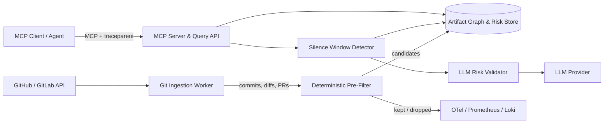
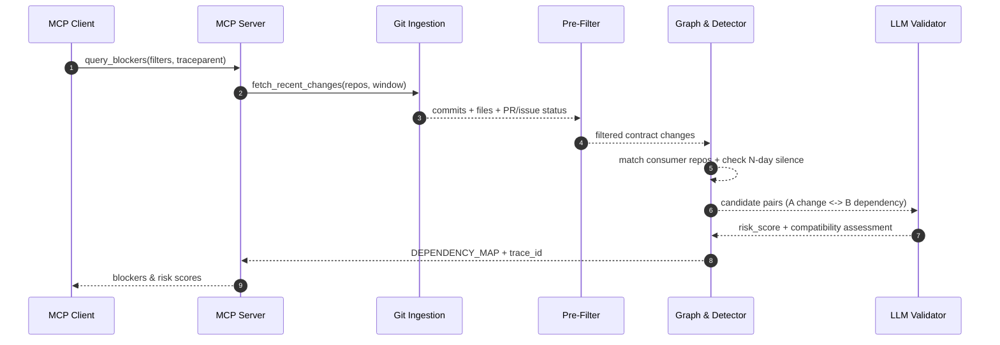
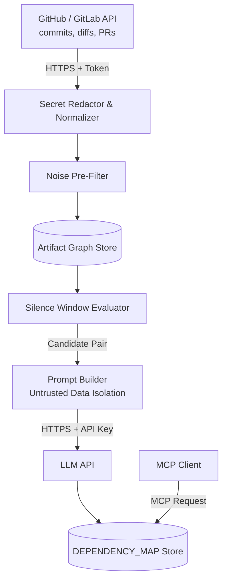

## Context
Сервис **Cross-Team Implicit Dependency Risk Agent** анализирует коммиты, изменённые файлы/диффы и статусы PR/issue в репозиториях GitHub/GitLab, строит кросс-репозиторный граф контрактов и зависимостей между командами и находит неявные блокировки по изменению артефактов и отсутствию реакции в зависимом репозитории за окно `N` дней. Анализ выполняется по модели cost-aware воронки (детерминированный пре-фильтр → граф артефактов и кандидаты → точечная LLM-валидация) и отдаётся через MCP-инструменты с телеметрией OpenTelemetry (`otel`, `prometheus`, `grafana`, `loki`) и целевыми SLO (`latency p95 <= 2000ms`, `availability >= 99.5%`, `error rate <= 1%`).

Ограничения проекта: интеграция с GitHub/GitLab API, реализация на Python, экспозиция через MCP-сервер, обязательный отсев шума до вызовов LLM и внедрение наблюдаемости с нуля по принципу *Observability by Design*.

## Goals / Non-Goals
**Goals:**
- Забирать метаданные коммитов, диффы/списки файлов и статусы PR/issue из GitHub/GitLab API за заданное окно.
- Отсекать шумовые коммиты детерминированными правилами до вызова LLM и считать предварительный скоринг.
- Строить и обновлять кросс-репозиторный граф артефактов (контракты, пакеты, схемы, миграции) с привязкой к командам.
- Выявлять пары «изменение артефакта в A ↔ зависимость в B» при отсутствии ответной активности в B в течение `N` дней.
- Валидировать отобранных кандидатов через LLM с оценкой риска и выдачей структурированного `DEPENDENCY_MAP` через MCP-инструменты.
- Обеспечить сквозную трассировку (`trace_id`), метрики, структурированные логи и маскирование секретов/чувствительных данных.

**Non-Goals:**
- Глубокий семантический разбор произвольного кода внутри всех языков без привязки к контрактам, манифестам и схемам на первом этапе.
- Полноценная замена систем проектного управления (Jira/Linear) или CI/CD-платформ.
- Автоматическое изменение кода в репозиториях пользователей или авто-мердж PR.

## Decisions
### Компонентная архитектура
Система строится как модульный Python-сервис с MCP-интерфейсом:
1. **Ingestion Service** — опрашивает GitHub/GitLab API, нормализует коммиты, изменённые файлы/диффы и статусы PR/issue с учётом rate limits и санитизацией секретов.
2. **Pre-Filter & Scoring Engine** — детерминированный фильтр шума (`merge`, `chore`, `docs`, `lint`, `typo`, неконтрактные пути) и эвристический пре-скоринг без вызовов LLM.
3. **Artifact Graph & Silence Detector** — строит граф зависимостей между репозиториями/командами по контрактам/пакетам/схемам и находит кандидатов на неявную блокировку по окну тишины `N` дней.
4. **LLM Risk Validator** — вызывается только для пар-кандидатов, оценивает совместимость изменений и формирует записи `DEPENDENCY_MAP` с `risk_score`.
5. **MCP Server & Query API** — предоставляет инструменты для получения зависимостей, кандидатов на блокировки и оценок риска с сохранением корреляционного контекста.
6. **Telemetry & Redaction Layer** — обеспечивает OpenTelemetry spans/metrics, structured JSON logs с redaction-фильтром и экспорт в Prometheus/Loki/OTel Collector.

### Потоки данных

### Data Flow Diagram (для Threat Modeling)

### Технологический стек
| Слой | Технология | Обоснование |
|---|---|---|
| Язык и рантайм | Python 3.12+ | Единый стек для ingestion, графа, MCP-сервера и OTel SDK |
| Интеграция с Git | GitHub/GitLab REST/GraphQL клиенты | Прямой доступ к коммитам, диффам, файлам и статусам PR/issue |
| Граф и состояние | SQLite (MVP) → PostgreSQL (>100 repos) | SQLAlchemy 2.0 ORM; SQLite без инфраструктуры для старта, миграция на PG при масштабе |
| ORM | SQLAlchemy 2.0 | Типизированные модели, alembic-миграции, единый интерфейс для SQLite/PostgreSQL |
| Протокол агентов | Model Context Protocol (MCP) | Стандартный интерфейс для вызовов инструментов агентами и оркестраторами |
| Наблюдаемость | OpenTelemetry SDK + Prometheus + Loki + Grafana | Прямое соответствие заданному observability-стеку и SLO |
| LLM-провайдер (v1) | YandexGPT (GPT-4o через YandexAI API или `yandexgptlatest` через YandexCloud) | Поддержка JSON-схемы response, fallback на внутренний аналог через тот же интерфейс |

### LLM-провайдер: YandexGPT (DEC-005)

- **API:** YandexCloud AI (`llm.generate` через gRPC/HTTP) или YandexAI (`yandexgptlatest`)
- **Аутентификация:** OAuth-токен (YandexOAuthToken) или IAM-токен
- **JSON-схема:** YandexGPT поддерживает `response_schema` (JSON Schema) — используется для валидации ответа в T-008
- **Fallback:** внутренний LLM-сервис через совместимый интерфейс
- **Конфигурация:** `config/llm.yaml` — `provider: yandexgpt`, `model: yandexgptlatest`, `folder_id`, `oauth_token`

### Детерминированные правила v1

**Артефакты (DEC-003):**
- OpenAPI: `openapi/**`, `api/**`, `*.openapi.yaml`, `*.openapi.json`
- Protobuf: `**/*.proto`
- Манифесты пакетов: `package.json`, `go.mod`, `requirements.txt`, `Cargo.toml`
- Миграции БД: исключены из v1 (roadmap v1.1)

**Окно тишины (DEC-001):**
| Тип артефакта | N (дни) | Обоснование |
|---|---|---|
| API-контракты (OpenAPI/Protobuf) | 7 | Критичные разрывы, ждут быстрее |
| Манифесты пакетов | 3 | Менее срочные, часто совместимые |

Значения переопределяются через `silence_window_days` в `AnalysisRunRequest`.

**Маппинг на команды (DEC-002):**
1. Parse `CODEOWNERS` из корня репозитория → `{ path_pattern → team }`
2. Fallback: `team-mapping.yaml` в `config/` → `{ repo → team }`
3. Если ни один источник не определён → команда `unknown`

### **Точки инструментирования**
| Сигнал | Где создаётся (файл/класс) | Тип | Auto/Manual | Атрибуты |
|--------|---------------------------|-----|-------------|----------|
| `dep_agent.request.duration` | `mcp_server/server.py` (`handle_tool_call`) | metric (histogram) | manual | `operation`, `status`, `trace_id` |
| `dep_agent.commits.filtered_total` | `filtering/pre_filter.py` (`PreFilter.evaluate`) | metric (counter) | manual | `repo`, `outcome`, `trace_id` |
| `dep_agent.llm.validation.duration` | `validation/llm_validator.py` (`LlmValidator.score`) | metric (histogram) | manual | `model`, `risk_level`, `trace_id` |
| `dep_agent.run.span` | `orchestrator/pipeline.py` (`AnalysisPipeline.run`) | span | manual | `repo.source`, `repo.target`, `trace_id` |
| `dep_agent.blocker.detected` | `detector/silence_detector.py` (`SilenceDetector.emit`) | log (structured) | manual | `source_repo`, `target_repo`, `risk_score`, `trace_id` |
| `security.secret.redacted` | `security/redactor.py` (`SecretRedactor.redact`) | log (audit) | manual | `secret_type`, `component`, `trace_id` |

### **Проброс корреляции**
- **W3C `traceparent`:** извлекается из входящего MCP/HTTP-контекста через OpenTelemetry propagator; при отсутствии создаётся новый root span с `trace_id`.
- **`X-Request-ID`:** принимается в заголовках/метаданных запроса, привязывается к текущему span/log контексту и при отсутствии генерируется UUID.
- **Service A → Service B:** при вызове Git API, LLM API и внутренних этапов пайплайна активный `traceparent` (и при наличии `X-Request-ID`) пробрасывается в исходящие заголовки/контекст вызова.

## Risks / Trade-offs
- **Риск**: неполный охват неявных зависимостей при опоре только на явные манифесты/контракты → **Митигация**: начать с ключевых артефактов (OpenAPI/Protobuf, манифесты пакетов, миграции) и расширять правила графа по мере эксплуатации.
- **Риск**: prompt injection через тексты коммитов, диффов или PR при валидации через LLM → **Митигация**: отделять системные инструкции от пользовательских данных, помечать текст репозитория как недоверенный ввод и валидировать ответ схемы.
- **Риск**: утечка токенов Git/LLM в логах или промптах → **Митигация**: прогонять строки через `SecretRedactor` до логирования и формирования LLM-запросов, фиксируя audit-событие `security.secret.redacted`.
- **Trade-off**: детерминированный пре-фильтр может отбросить редкий нестандартный коммит → **Митигация**: настраиваемый список исключений и метрика `dep_agent.commits.filtered_total` для контроля доли отсева.

## Migration Plan
1. Развернуть базовый каркас проекта с OTel-инструментированием, `SecretRedactor` и конфигурацией SLO-метрик/логов.
2. Подключить ingestion из GitHub/GitLab API и детерминированный пре-фильтр коммитов.
3. Реализовать кросс-репозиторный граф артефактов и детектор окна тишины `N` дней.
4. Подключить LLM-валидатор кандидатов, генерацию `DEPENDENCY_MAP` и MCP-инструменты.
5. Проверить дашборды Grafana, алерты Prometheus, логи в Loki и провести canary-запуск на пилотном наборе репозиториев.

## Open Questions
- <нет>