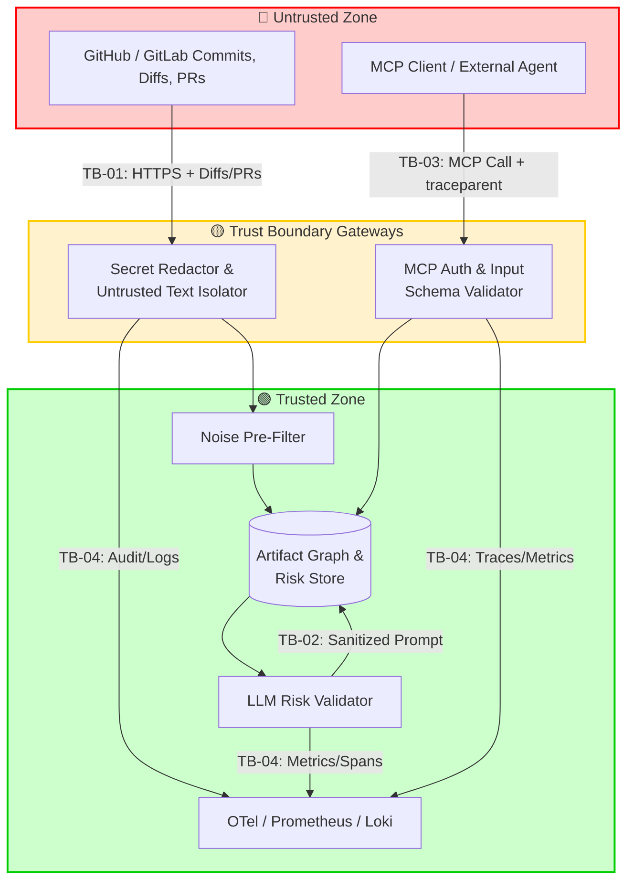

## 1. Выбор методологии
- **Выбрано:** OWASP Top 10 for LLM + STRIDE (комбинированно)
- **Обоснование:** В `security_context` присутствует AI-компонент (`ai: ["agent"]`) и чувствительные активы (`assets: ["repo-metadata", "tokens", "internal-schemas"]`) при отсутствии PII/регуляторики персональных данных. Агент обрабатывает недоверенные тексты репозиториев (коммиты, диффы, PR/issue) и взаимодействует с внешними/внутренними API и MCP-слоем, поэтому требуется оценка как LLM-специфичных рисков (prompt injection, excessive agency/tool abuse, утечка контекста), так и классических угроз безопасности API/токенов/данных (STRIDE).
- **Отвергнутые альтернативы:**
  - *Только STRIDE* — не покрывает специфику агентов и prompt injection в диффах/коммитах/MCP-инструментах.
  - *Только OWASP Top 10 for LLM* — не покрывает классические угрозы для токенов доступа, графового хранилища и API-взаимодействий.
  - *LINDDUN* — фокус на приватность/PII при регуляторике персональных данных; в текущем контексте акцент на токенах, внутренних схемах и агентном поведении.
  - *Baseline* — неприменим из-за наличия `agent` и секретов (`tokens`).
- **Скоуп:** Git Ingestion Worker, Secret Redactor, Pre-Filter, Artifact Graph & Silence Detector, LLM Risk Validator, MCP Server и слой телеметрии (`otel`/Prometheus/Loki).

## 2. Активы и классификация данных
| Актив | Класс данных | Компонент | Владелец |
|---|---|---|---|
| GitHub/GitLab & LLM API токены | secret | Ingestion Service, LLM Validator, Telemetry/Redactor | platform-team |
| Коммиты, диффы, описания PR/issue | untrusted / internal | Ingestion Service, Pre-Filter, LLM Validator | source-teams |
| Граф артефактов и внутренние схемы/контракты | internal | Artifact Graph Store, MCP Server | engineering-teams |
| `DEPENDENCY_MAP` и оценки рисков | internal | Silence Detector, Risk Store, MCP Server | platform-team |
| Телеметрия (спаны, метрики, логи, `trace_id`) | internal / audit | OTel / Prometheus / Loki | platform-team |

## 3. Границы доверия (Trust Boundaries)
| ID | Граница | Откуда → Куда | Контроль безопасности |
|----|---------|---------------|----------------------|
| TB-01 | Внешние репозитории → Ingestion & Redactor | untrusted/external → trusted | HTTPS/TLS, токен с минимальными правами (read-only), маскирование секретов (`SecretRedactor`) до логирования и промптов |
| TB-02 | Подготовленный контекст → LLM API | trusted/sanitized → external LLM | Изоляция недоверенных данных (разделение инструкций и данных), отсутствие секретов, валидация ответа по схеме |
| TB-03 | MCP Client / Agent → MCP Server | untrusted/caller → trusted | Аутентификация/авторизация вызывающего клиента, валидация параметров фильтров, возврат `trace_id` без утечки внутренних секретов |
| TB-04 | Приложение → OTel / Prometheus / Loki | trusted → telemetry backend | Redaction секретов перед записью логов/атрибутов, контроль ретеншна и доступа к логам/дашбордам |

## 4. Визуализация потоков данных (цветовая кодировка)
**Легенда:**
- 🟢 **Trusted** — компоненты под нашим контролем
- 🔴 **Untrusted** — внешние источники ввода / вызывающие клиенты
- 🟡 **Boundary / Gateway** — точки пересечения границ и санитизации

## 5. Матрица угроз
**Risk Scoring:** `Risk = Likelihood (1–5) × Impact (1–5)`, максимум `25`. **Top-3** — угрозы с наивысшим Risk для immediate mitigation.

| ID | Категория (OWASP LLM / STRIDE) | Угроза | Вектор | Актив | TB | L | I | Risk | Контроль | Requirement |
|----|-------------------------------|--------|--------|-------|----|---|---|------|----------|-------------|
| TM-01 | LLM01 / T (Tampering) | Indirect Prompt Injection через тексты коммитов, диффов и PR при оценке кандидатов через LLM | Вредоносный текст в commit message / diff / PR body | `DEPENDENCY_MAP` и оценки рисков | TB-01, TB-02 | 4 | 4 | **16** | Разделение системных инструкций и данных, экранирование/маркировка untrusted-полей, строгий JSON-схемный парсер ответа | NFR-SEC-001 |
| TM-02 | LLM02 / I (Information Disclosure) | Утечка токенов Git/LLM или чувствительных фрагментов кода/схем в логи (Loki), метрики или промпты LLM | Неотредактированный секрет в диффе/ошибке/промпте | Токены API, внутренние схемы, телеметрия | TB-01, TB-02, TB-04 | 3 | 5 | **15** | `SecretRedactor` до записи в логи/промпты, audit-лог `security.secret.redacted`, запрет секретов в атрибутах спанов/метрик | NFR-SEC-002, NFR-OBS-001 |
| TM-03 | LLM06 / E (Elevation of Privilege) | Excessive Agency / злоупотребление MCP-инструментами или превышение прав токена Git при запросах агента | Вызов MCP-инструментов с широкими параметрами или избыточный scope токена | Граф артефактов, токены API | TB-01, TB-03 | 3 | 4 | **12** | Read-only scope для Git API, жёсткая схема аргументов MCP-инструментов, контроль доступа к MCP-эндпоинту | NFR-SEC-003 |
| TM-04 | D (Denial of Service) / LLM10 | Исчерпание rate limit Git/LLM API или лавинообразный рост LLM-вызовов при больших репозиториях | Большое окно коммитов или обход пре-фильтра | Ingestion, LLM Validator, доступность сервиса | TB-01, TB-02 | 3 | 3 | **9** | Детерминированный пре-фильтр до LLM, лимит кандидатов на прогон, backoff/retry с учётом rate limit и SLO | NFR-SEC-004, NFR-001 |

### Top-3 для immediate mitigation
1. **TM-01 (Risk 16)** — Indirect Prompt Injection из текстов коммитов/диффов/PR в LLM-валидаторе → `NFR-SEC-001`, P0
2. **TM-02 (Risk 15)** — Утечка секретов/токенов в промптах LLM или логах Loki/трейсах → `NFR-SEC-002`, P0
3. **TM-03 (Risk 12)** — Избыточные права токенов или невалидный/неавторизованный вызов MCP-инструментов → `NFR-SEC-003`, P1

## 6. Требования безопасности (→ в spec.md и design.md)
| Requirement | Описание | Покрывает TM | Метрика / verify |
|-------------|----------|--------------|------------------|
| NFR-SEC-001 | Изоляция текстов коммитов/диффов/PR как untrusted-данных и строгая валидация выходной схемы LLM-валидатора | TM-01 | 100% ответов LLM валидируются по схеме; 0 успешных injection-переопределений `risk_score` в `TC-SEC-001` |
| NFR-SEC-002 | Маскирование секретов/токенов (`SecretRedactor`) до отправки в LLM и записи в логи/трейсы с фиксацией `security.secret.redacted` | TM-02 | 0 необработанных тестовых токенов в логах/промптах; событие `security.secret.redacted` зафиксировано в `TC-SEC-002` |
| NFR-SEC-003 | Принцип наименьших привилегий для Git-токенов (read-only) и валидация входных аргументов MCP-инструментов | TM-03 | Отказ на невалидных параметрах и неавторизованных вызовах в `TC-SEC-003` |
| NFR-SEC-004 | Ограничение объёма LLM-валидации на прогон и обработка rate-limit/ошибок без нарушения `NFR-001` | TM-04 | Соблюдение лимита кандидатов на прогон и `error rate <= 1%` под нагрузкой в `TC-SEC-004` |

## 7. Влияние на ADR
- **ADR-кандидат (безопасность + архитектура промпта/MCP):** формат изоляции untrusted-данных в LLM-валидаторе и схема валидации ответа (`NFR-SEC-001`, `TM-01`).
- **ADR-кандидат (безопасность + наблюдаемость):** архитектура `SecretRedactor` и политика санитизации логов/спанов/промптов (`NFR-SEC-002`, `NFR-OBS-001`, `TM-02`).
- **ADR-кандидат (хранилище и MCP):** выбор хранилища графа/состояния и модель прав доступа/ограничений для MCP-инструментов (`NFR-SEC-003`, `NFR-SEC-004`, `TM-03`, `TM-04`).